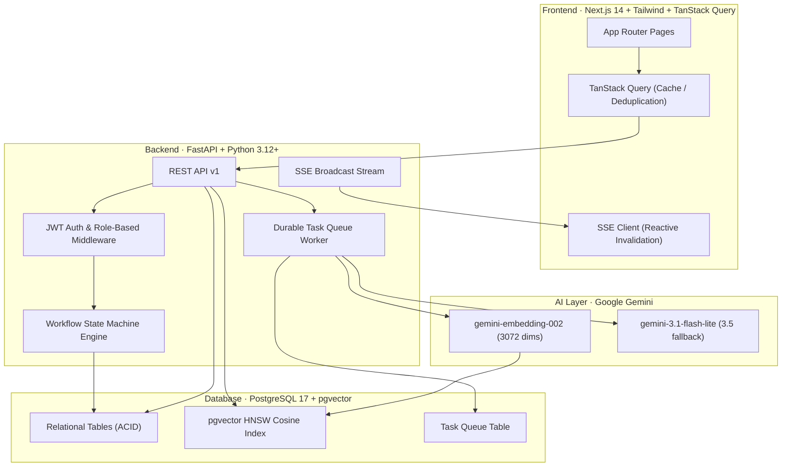

# OpFlow — Operational Work Management Platform

**OpFlow** is a full-stack operational coordination platform engineered for the **Newtonite Software Engineering Challenge**. It replaces fragmented chat, email, and spreadsheet tracking with a unified system offering strict workflow enforcement, optimistic concurrency conflict detection, resource-level authorization, and RAG-driven AI triage.

---

## Architecture Overview



---

## Key Features & Critical Behaviours

The platform addresses all four core engineering scenarios outlined in the challenge brief:

1. **Optimistic Concurrency Control (HTTP 409 Conflict)**
   - Every work item maintains a monotonic `version` counter.
   - Mutating requests (`PUT`, status transition, assignment) require `expected_version`.
   - The database executes atomic conditional updates (`WHERE id = :id AND version = :expected_version`).
   - If a collision occurs, the server rejects the request with HTTP 409 Conflict, and the frontend displays a non-destructive conflict resolution dialog to reload the latest state.

2. **Idempotent Operations (`Idempotency-Key` Header)**
   - Mutating POST/PUT endpoints support client-generated idempotency keys.
   - Cached responses are returned automatically on network retries or accidental double-clicks within a 24-hour TTL window, preventing duplicate incident records.

3. **Workflow State Machine & Role Guards**
   - Workflows are defined per team with explicit permitted transitions.
   - Transitions (e.g. `in_review -> resolved` approval) are strictly guarded by team roles (`admin`, `lead`, `member`, `viewer`).
   - Enforced server-side at the service boundary.

4. **Resource-Level Authorization (Query Boundary)**
   - Users can only view, query, or mutate work items belonging to teams where they hold active membership.
   - Enforced directly in SQL queries (`WHERE team_id IN (:user_accessible_teams)`), preventing data leaks even via crafted direct API calls.

5. **AI / RAG Integration (pgvector + Google Gemini)**
   - **Semantic Vector Search**: Work items are embedded into 3072-dimensional vectors using `gemini-embedding-002`. Users can query by operational concept rather than exact keywords.
   - **Duplicate Detection**: Real-time cosine similarity search identifies potential duplicate work items before and during creation.
   - **AI-Powered Triage & Assignment**: Generative triage using `gemini-3.1-flash-lite` (with automatic failover to `gemini-3.5-flash-lite`) produces summaries, next steps, and suggests assignees based on team rosters.
   - **Durable Asynchronous Queue**: Heavy AI enrichment runs in a background queue with retry tracking and stuck-task reclamation, keeping the primary work item creation path instantaneous.

6. **Real-Time Reactive Updates (Server-Sent Events)**
   - The backend pushes lightweight invalidation signals over SSE.
   - TanStack Query automatically refetches stale caches, delivering immediate synchronization across multiple open browser tabs.

---

## Tech Stack

| Layer | Technology |
|---|---|
| **Backend** | Python 3.12+, FastAPI, SQLAlchemy 2.0 (Async), asyncpg, PyJWT, bcrypt, Pydantic v2 |
| **Frontend** | Next.js 14 (App Router), TypeScript, Tailwind CSS, TanStack Query v5, Lucide React |
| **Database** | PostgreSQL 17 with `pgvector 0.8.7` |
| **AI Models** | Google Gemini `gemini-embedding-002` (vectors) and `gemini-3.1-flash-lite` (generation) |
| **Deployment** | Docker Compose (multi-container), Dockerfiles for Cloud Run / Vercel |

---

## Prerequisites

- [Docker](https://docs.docker.com/get-docker/) & [Docker Compose](https://docs.docker.com/compose/)
- Python 3.12+ (for local test execution outside Docker)
- Node.js 18+ (for local frontend development outside Docker)

---

## Quickstart (Docker Compose)

1. **Clone and enter the repository:**
   ```bash
   git clone https://github.com/Dhruv1249/newtonite-assessment.git
   cd newtonite-assessment
   ```

2. **Configure environment variables:**
   Copy `.env.example` to `.env` (or verify that `.env` contains your Gemini API key and credentials):
   ```bash
   cp .env.example .env
   ```

3. **Start the complete stack:**
   ```bash
   docker compose up -d
   ```

4. **Seed demo data (users, teams, workflows, work items):**
   ```bash
   docker compose exec backend python app/seed.py
   ```

5. **Access the application:**
   - **Frontend UI**: [http://localhost:3000](http://localhost:3000)
   - **Backend API & Swagger Docs**: [http://localhost:8000/docs](http://localhost:8000/docs)
   - **Healthcheck**: [http://localhost:8000/health](http://localhost:8000/health)

---

## Demo Evaluator Accounts

The database seeder provisions accounts covering all four permission levels with the password `password123`:

| Role | Email | Password | Permissions |
|---|---|---|---|
| **Admin** | `admin@opflow.internal` | `password123` | Full control across all teams, workflows, and settings |
| **Lead** | `lead@opflow.internal` | `password123` | Can assign work, approve review transitions, and triage |
| **Member** | `engineer@opflow.internal` | `password123` | Can create items, edit assigned items, submit for review |
| **Support** | `support@opflow.internal` | `password123` | Member role within Customer Operations |
| **Viewer** | `auditor@opflow.internal` | `password123` | Read-only inspection across all items and audit logs |

> **Evaluator Tip:** The application header contains a fast persona switcher dropdown so you can seamlessly test permission gates and role restrictions with a single click.

---

## Automated Backend Integration Tests

Automated integration tests validate the critical architectural behaviors using `pytest` and `httpx`:

```bash
# Run tests inside the virtual environment
PYTHONPATH=backend .venv/bin/pytest -v backend/tests/
```

### Test Coverage Highlights:
- `test_concurrency.py`: Verifies that concurrent updates on stale version vectors trigger `HTTP 409 Conflict`.
- `test_idempotency.py`: Verifies that identical requests with matching `Idempotency-Key` headers return cached responses without duplicate database records.
- `test_workflow.py`: Validates valid lifecycle transitions and verifies that approval transitions are rejected with `HTTP 403 Forbidden` when attempted by unauthorized roles.
- `test_authorization.py`: Verifies query-level tenant isolation (users cannot fetch items belonging to teams they do not belong to) and read-only enforcement for Viewers.
- `test_ai_service.py`: Verifies semantic vector search querying and cosine similarity ranking.

---

## Architectural Decisions Document

For an in-depth explanation of trade-offs, concurrency models, and deliberate design choices, refer to:
[ENGINEERING_DECISIONS.md](file:///home/dhruv/newtonite-assessment/ENGINEERING_DECISIONS.md)

---

## Known Limitations

As designed for a one-day implementation, the system contains the following documented boundaries:
1. **Unidirectional SSE instead of WebSockets**: Uses Server-Sent Events to trigger client-side cache invalidations. Collaborative cursor presence or character-by-character live co-editing would require WebSockets and operational operational CRDTs.
2. **Form-Based Workflow Editor**: The workflow definition editor is form-based rather than an interactive SVG drag-and-drop node graph.
3. **No External SMTP/SMS**: Notifications are presented through real-time in-app SSE streams rather than transactional email gateways.
4. **Single-Region PostgreSQL**: High availability relies on container restart policies rather than geo-replicated database clusters.
